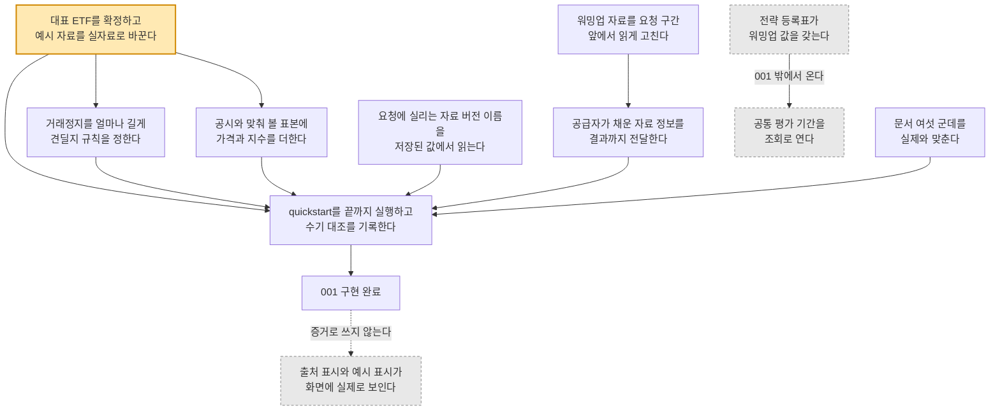

# spec 001 남은 작업 — 무엇을 더 해야 끝나는가

> **이 브리프는 작업 묶음 하나가 아니라 spec 001 전체를 대상으로 한다.** 스킬의 표기 관례와
> 분량 기준은 그대로 따르되 범위만 넓혔다. 묶음 단위 브리프가 필요하면 각 티켓마다 따로 쓴다.

| | |
|---|---|
| spec | `specs/001-etf-market-data` |
| 대상 | T014~T021·T023·T025~T028 (남은 13개) |
| 브랜치 | `docs(be)/001-remaining-work` |
| 모드 | after — T001~T013이 `dev`에 병합된 뒤 남은 간극을 본다 |
| 작성 | 2026-09-14 |

## 한 줄 요약

사용자에게: 섹터를 고르면 진단을 시작할 수 있게 되었으나 **대표 ETF가 아직 예시 값**이다.

시스템에: 수집·저장·조회 경로는 열렸고, 남은 13개는 **실자료 3 · 계약 경계 4 · 문서 6**으로 갈린다.

## 도식

### 남은 일 중 무엇이 무엇을 막고 있고, 어디까지가 001 손으로 닫히는가?

**대표 ETF 확정이 병목이다.** 회색 점선 셋은 **001이 혼자 닫을 수 없는 것**이고, 맨 아래 점선은
구현 완료를 화면 확인의 증거로 쓰지 말라는 constitution의 요구다.

각 칸이 실제로 무엇인지 확인하기

| 도식의 이름 | 실제로 가리키는 것 | 이렇게 부르는 까닭 |
|---|---|---|
| 대표 ETF를 확정하고… | T014 / `S15P21E205-186` | PD-01이 미확정이라 지금 대응표가 예시 여섯 건이고 응답에 예시 표시가 붙는다 |
| 거래정지를 얼마나… | T015 / `S15P21E205-187` | PD-19·PD-20. 쌓인 정지 구간 기록이 판단 입력이라 실자료가 먼저다 |
| 공시와 맞춰 볼 표본에… | T020 | 지금 표본이 상장일·분배금·분할만 담고 가격과 지수가 빠져 SC-002를 절반만 덮는다 |
| 워밍업 자료를… | T018 | 2026-09-14에 001 계약을 따르기로 정했다. 뒤에 오는 자료 정보 전달과 같은 파일을 고친다 |
| 요청에 실리는 자료 버전 이름을… | T019 | 지금 요청에 고정 문자열이 실려 나가 실제로 쓴 묶음과 다른 이름이 기록된다 |
| 공급자가 채운 자료 정보를… | T021 | 마감 시각·정지 표시·예시 표시가 공급자에서 멈추고 결과까지 닿지 않는다 |
| 문서 여섯 군데를… | T023·T025·T026·T027·T028 | 서로 얽히지 않아 한 묶음으로 몰 수 있다 |
| quickstart를 끝까지… | T016 / `S15P21E205-188` | 검증 기록이 앞의 결과를 담아야 해서 반드시 마지막이다 |
| 공통 평가 기간을 조회로 연다 | T017 | 산식은 이미 픽스처로 검증까지 끝났고 호출부만 없다 |
| 전략 등록표가 워밍업 값을… | spec 003 | 계약이 "001은 이 값을 정하지 않고 받는다"고 못 박았다 |
| 출처 표시와 예시 표시가… | SC-005·SC-006 / spec 002·003·005 | 두 기준이 "화면의 100%"를 요구하는데 001에는 화면이 없다 |

## 핵심 결정

- **워밍업 자료는 요청 구간보다 앞에서 읽는다** — `contracts/market-dataset.md` 「읽기 규칙」, 2026-09-14 확정
- **추적 차이는 이번 범위에서 뺀다** — `spec.md` Out of Scope, 결정 항목 PD-21
- **공통 평가 기간 조회는 003에 위임한다** — `contracts/evaluation-window.md` 입력표

## 퀴즈

**Q1. 남은 13개를 모두 마치면 spec 001이 완료되는가?**
근거: `constitution.md` 「완료의 정의」

답

아니다. **구현 완료까지만 도달한다.**

**기능 단위의 완료는 세 층으로 나뉜다.** 구현 완료 · 사용성 확인 · 효과 입증이며, constitution이
**하나를 다른 것의 증거로 쓰지 말라**고 못 박았다. 남은 13개는 첫 층만 채운다.

**사용성 확인은 001이 할 수 없다.** 관찰할 화면이 없기 때문이다. 화면을 가진 spec에서 수행한다.

**효과 입증은 001에 해당하지 않는다.** 그 절차는 전략 선정과 경제환경 검색의 탐색·검증을 가르는
규칙이라, 자료를 확보하는 이 spec에는 적용할 대상이 없다.

**Q2. SC-005(출처 표시)와 SC-006(예시 자료 표시)을 001이 혼자 닫을 수 있는가?**
근거: `spec.md` SC-005·SC-006

답

없다. 두 기준이 **"화면의 100%"**를 요구하기 때문이다.

**001의 몫은 값을 내보내는 데까지다.** 자료 출처 문구와 예시 여부 표시를 응답에 실어 보내는
것까지가 001이고, 그 값을 화면에 띄우는 것은 섹터 선택·전략 설정·결과 화면을 가진 spec의 일이다.

**그래서 검증 기록에는 "001이 값을 내보내는 것까지 확인"이라고만 쓴다.** 화면 확인을 001의
통과로 적으면 출처가 실제로 안 보여도 확인된 것처럼 남는다.

**Q3. 공통 평가 기간 조회(FR-007)를 001이 지금 붙이지 못하는 까닭은?**
근거: `contracts/evaluation-window.md` 입력표, `spec.md` FR-007

답

산식에 넣을 워밍업 길이를 **001이 가지고 있지 않기 때문이다.**

**그 값은 전략 등록표에서 온다.** 계약의 입력표가 그 칸의 출처를 전략 등록표로 적고, 본문이
"001은 이 값을 정하지 않고 받는다"고 못 박았다. 워밍업은 전략의 관측 기간에 최근 제외 구간을
더한 값이라 전략을 아는 쪽만 정할 수 있다.

**지어내면 원칙을 어긴다.** 값을 임의로 채운 조회를 열면, 읽는 쪽은 그것이 근거 있는 값인지
알 수 없다. 값이 없을 때는 표면을 만들지 않는 편이 낫다.

**산식 자체는 이미 끝났다.** 입력을 전부 인자로 받게 만들어 두었고 워커와 백엔드가 같은 픽스처로
검증한다. 전략 등록표가 값을 갖게 되면 호출부만 붙이면 된다.

**Q4. 워밍업 자료를 요청 구간 앞에서 읽기로 한 결정은 무엇을 바꾸는가?**
근거: `contracts/market-dataset.md` 「읽기 규칙」

답

**요청한 구간 전체가 성과 집계에 들어간다.** 지금은 앞부분이 워밍업에 쓰여 빠진다.

**한 해를 60거래일 워밍업으로 요청했다고 하자.** 지금은 그 해 안에서 60거래일을 워밍업에 쓰고
석 달쯤 지난 뒤부터 집계한다. 계약대로 고치면 **앞 해의 마지막 석 달을 더 읽어** 워밍업을 채우고
집계는 요청한 첫날부터 시작한다.

**달력 일수가 아니라 거래일로 세는 것이 핵심이다.** 달력 일수로 잡으면 연휴가 긴 해에 워밍업이
모자란다.

**고치면 모든 백테스트의 집계 시작일과 지표가 움직인다.** 기존 재현 픽스처가 함께 깨지는데,
이는 구현이 틀려서가 아니라 의도가 바뀐 것이므로 픽스처를 고치는 편이 맞다.

확인: `worker/src/worker/engine_runner.py`

**Q5. 대표 상품 정보에 추적 차이가 없는 것은 빠뜨린 것인가?**
근거: `spec.md` Out of Scope, 결정 항목 PD-21

답

아니다. **계산 정의가 확정되지 않아 의도적으로 뺐다.**

**기획서는 이 항목을 들었으나 어떻게 계산하는지는 정하지 않았다.** 정의 없이 숫자를 내면 읽는
쪽이 그 값을 믿을 근거가 없다. 그래서 범위에서 빼고 결정 항목으로 남겼다.

**정의가 확정되면 다시 들어온다.** 그때는 이 spec을 고치는 것이 아니라 새 작업으로 온다.

## 불일치

앞선 converge 판정(2026-09-13)이 task로 옮긴 것들이며, **아직 닫히지 않았다.**

- `[SPEC위반]` `ExecutionPolicy.java:43`이 `"KRX_DAILY_V1"` 고정 — 규칙은 `KRX_DAILY_{YYYYMMDD}`.
  선택은 `dataVersion`(null)이 하므로 자료는 옳으나 **기록에 쓰지 않은 이름이 남는다.** → T019
- `[SPEC위반]` `engine_runner.py`가 `market_data.load(..., warmup_trading_days=)`를 넘기지 않아
  기본값 0으로 읽는다 — `contracts/market-dataset.md` 「읽기 규칙」 위반. → T018
- `[SPEC위반]` `engine_runner.py`가 `market.metadata`를 읽지 않아 마감 시각·정지 표시·예시 표시가
  결과에 닿지 않는다 — FR-006·FR-014. → T021
- `[SPEC위반]` `GET /sectors/evaluation-window` 호출부 없음 — `contracts/sector-api.md`가 정의했다.
  **001 밖의 값이 필요해 지금 닫을 수 없다.** → T017, spec 003 위임
- `[SPEC위반]` `build_queried_values`가 가격·지수를 채우지 않는다 — FR-016·SC-002. → T020
- `[SPEC공백]` `sector_map.py:501-556`이 `instrumentId`·`listedOn`·`benchmarkIndex`를 받고 표본
  `contracts/fixtures/sample-sector-map.json`이 그것을 고정한다 — `S15P21E205-189`의
  「파이프라인 입력 파일은 snake_case」와 갈린다. **2026-09-14에 새로 찾았고 task가 없다.**

## 확인하지 못한 것

- `contracts/fixtures/evaluation-window-cases.json`의 `instrumentId`가 입력인지 응답인지 보류했다.
  응답이면 camelCase가 맞아 위 마지막 항목에 해당하지 않는다.
- SC-002의 수기 대조는 사람이 해야 한다. 운용사 공시를 눈으로 보고 맞추는 작업이다.
- 문서 여섯 중 T016을 뺀 다섯은 내용을 직접 읽지 않고 converge 판정을 옮겼다.
