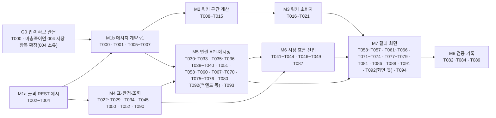

# Tasks: 경제환경 사례와 전략 비교 연결

**Input**: Design documents from `specs/011-regime-strategy-link/`

**Prerequisites**: [plan.md](plan.md), [spec.md](spec.md), [research.md](research.md), [data-model.md](data-model.md), [contracts/](contracts/), [quickstart.md](quickstart.md)

**Tests**: 포함한다. constitution "완료의 정의" 조건 2가 *"테스트 또는 동작 확인 완료"* 를 Task 완료
조건으로 못 박아 선택 사항이 아니다. 011의 숫자는 전부 워커 `slicer.py`에서 나오므로 시험의 무게중심은
워커 수기 대조(S2)와 백엔드 판정(S4·S5)에 있다.

**Organization**: Phase는 spec의 사용자 스토리(US1~US5) 순서다. 브랜치·MR·Jira Task 단위는 아래
**묶음 표(M1a~M8)** 이며 스토리와 1:1이 아니다 — 011은 파트가 셋(BE·WK·FE)이라 같은 스토리 안에서도
브랜치가 갈린다. 묶음마다 태스크 번호를 명시한다.

## Format: `[ID] [P?] [Story] (파트) Description`

- **[P]**: 다른 파일을 만지고 선행 태스크가 없어 병렬 실행 가능
- **[US1]~[US5]**: spec.md의 사용자 스토리. Setup·Foundational·Polish에는 붙지 않는다
- **(파트)**: 작업 종류. 브랜치 position은 묶음 표가 정한다

| 파트 태그 | 대상 | position |
|---|---|---|
| `(DB)` | Flyway 마이그레이션 | `be` |
| `(BE)` / `(BE 테스트)` | 백엔드 Java / JUnit·Testcontainers | `be` |
| `(WK)` / `(WK 테스트)` | 워커 Python / pytest | `be` — 워커는 별도 position이 없어 004와 같이 `be`를 쓴다 |
| `(FE)` / `(FE 테스트)` | 프론트엔드 React·TS / Vitest | `fe` |
| `(DOCS)` | 문서·계약 픽스처·수동 확인 기록 | `be` |

`data/`는 **변경하지 않는다.** 010 표·004 표는 읽기만 한다. 010 `regime` 도메인·004 `backtest` 도메인·
005 `result` 도메인의 코드는 고치지 않는다(읽기는 애플리케이션 서비스·리포지토리 인터페이스로).

---

## 브랜치 묶음 — 이 표가 티켓·브랜치·MR 단위다

**`T###`는 브랜치 단위가 아니다.** constitution "Jira 연계"가 `작업 묶음 = 1 Branch = 1 MR`로 정하므로
브랜치·MR·Jira Task 단위는 아래 **9개 묶음**이다. M1은 골격(M1a)과 메시지 계약(M1b)으로 나눈다 —
가용성 판정 줄(M4)이 구간 입력 대조(T000)를 기다리지 않고 먼저 갈 수 있게 하려는 것이다.

| 묶음 | 브랜치 | 파트 | Jira 제목(안) | 태스크 | 검증 명령 |
|---|---|---|---|---|---|
| **M1a** | `feat(be)/{티켓}-regime-link-skeleton` | DOCS·BE·WK | `[BE] 사례 연결 백엔드·워커 골격과 REST 계약 예시` | T002~T004 | `cd backend && ./gradlew spotlessApply build` · `cd worker && ruff check src tests scripts && ruff format --check src tests scripts && pytest` |
| **M1b** | `feat(be)/{티켓}-regime-link-contract` | DOCS·BE·WK | `[BE] 사례 연결 메시지 계약 v1과 구간 입력 대조` | T000~T001, T005~T007 | 〃 |
| **M2** | `feat(be)/{티켓}-regime-link-slicer` | WK | `[BE] 사후 구간 잘라내기·요약 계산` | T008~T015 | `cd worker && ruff check … && pytest` |
| **M3** | `feat(be)/{티켓}-regime-link-consumer` | WK | `[BE] 사례 연결 워커 소비자와 엔트리포인트` | T016~T021 | 〃 |
| **M4** | `feat(be)/{티켓}-regime-link-availability` | DB·BE | `[BE] 사례 연결 표와 가용성 판정 조회` | T022~T029, T034, T045, T050, T052, T090 | `cd backend && ./gradlew spotlessApply build` |
| **M5** | `feat(be)/{티켓}-regime-link-api` | BE | `[BE] 사례 연결 생성·시나리오·재계산 API` | T030~T033, T035~T036, T038~T040, T051, T058~T060, T067~T070, T075~T076, T080, T092(백엔드 몫), T093 | 〃 |
| **M6** | `feat(fe)/{티켓}-regime-link-start` | FE | `[FE] 시장 흐름 진입과 003 분석 기간 제약` | T041~T044, T046~T049, T087 | `cd frontend && npm run lint && npm run build && npm test` |
| **M7** | `feat(fe)/{티켓}-regime-link-page` | FE | `[FE] 사례 검색 가용성과 전략 결과 영역` | T053~T057, T061~T066, T071~T074, T077~T079, T081, T086, T088, T091, T092(화면 몫), T094 | 〃 |
| **M8** | `docs(be)/{티켓}-regime-link-verification` | DOCS | `[DOCS] quickstart 실행 기록과 교차 spec 후속` | T082~T084, T089 | 수동 — quickstart.md S1~S10 |

**묶음 순서**: M1a → M1b → (M2 → M3) ∥ (M4 → M5) → M6 → M7 → M8. **M4·M5(백엔드)는 M1a 뒤 바로
갈 수 있고 M2·M3(워커)는 M1b의 계약 픽스처만 공유하므로, 두 줄은 병렬로 딸 수 있다.** M6·M7은 M5의
응답을 읽고, M7은 dev에 있는 010 결과 목록 컴포넌트(`components/regime/`)를 재사용한다(research R8).
M4는 dev의 010 표에 FK를 바로 걸고 010 리포지토리를 읽는다 — 대역을 두지 않는다. 조회 API(T045·T050·T052)는 판정과 같은 컨트롤러·같은 MR이라
스토리 태스크이지만 M4에 둔다.

### 묶음 의존 그래프 (2026-09-20)

목적 단위는 위 묶음 그대로이고, 입력 확보 관문(T000)만 따로 떼어 본다. **가용성 판정 줄(M4)은 T000과
메시지 계약에 기대지 않으므로 처음부터 병렬로 갈 수 있다.**



| 순서가 필요한 곳 | 이유 |
|---|---|
| G0 → M1b → M2 → M3 | 계산 픽스처는 입력 모양이 증명돼야 동결할 수 있고, 소비자는 계산 함수를 부른다 |
| M1a → M4 → M5 | 패키지 골격 뒤에 표·판정, 그 위에 링크 생성·이벤트 반영. M5의 작업 조립(T026·T031)은 G0도 필요하다 |
| M4 → M6(시작), M5 → M6(마무리) | 시작 화면·003 제약·010 진입 버튼은 구간 조회(T045)만 있으면 되고, 결과 영역(T048)은 M5 응답이 필요하다 |
| M3·M5·M6 → M7 → M8 | 결과 화면은 실제 계산 결과와 API 위에서 확인하고, 검증 기록은 전부 뒤다 |

| 병렬로 갈 수 있는 곳 | 조건 |
|---|---|
| G0 ∥ M1a ∥ M4 | 서로 다른 파일. M4는 워커·메시지 계약과 무관하다 |
| (M2 → M3) ∥ (M4 → M5의 판정·검색 기록 T051·T075) | 워커 줄과 백엔드 줄은 M1b 픽스처만 공유한다 |
| M6의 T043·T044·T046·T087 ∥ M5 | 프론트 진입 작업은 M4만 있으면 시작한다 |
| M7 안의 T086·T088·T091 | 005 진입 버튼·당시 뉴스·탐색 상태 훅은 서로 다른 파일이고 결과 영역과 독립이다 |

### 묶음별 MR 체크포인트

| 묶음 | 머지 전에 이것이 참이어야 한다 |
|---|---|
| M1a | `regimelink` 4계층 패키지가 `ArchitectureTest`를 통과. REST 예시 파일 여섯이 계약 §1~§3과 같고 어디에도 내부 PK가 없다. 워커 `regime_link` 모듈 자리가 있고 백테스트 소비자(`worker/consumer.py`·`worker/rabbitmq.py`·`worker/main.py`)는 바뀌지 않았다 |
| M1b | 구간 입력 독립 대조(T000) 근거가 research R3에 남았다. 픽스처 7개가 백엔드·워커 양쪽 계약 테스트를 round-trip으로 통과. 토폴로지 상수는 계약 문서와 대조하고 Java 파일 대조는 T030이 있는 M5에서 통과 |
| M2 | 수기 대조(`manual_reconciliation.json`)와 `window63`·`window21`·`kospi`가 일치. 미완성 입력(34거래일)에서 `tradingDays=34`·`complete=false`. 수익률·낙폭 연환산 없음. 회전율 단위 명시. 전체 손익 0이면 손실 기여 생략. `FRESH_CASH`는 `initialCash` 기준 |
| M3 | 계약 오류 → DLQ, 계산 실패 → `FINISHED(FAILED)` + ACK, 발행 실패 → requeue. `FINISHED` 확인 전 ACK 경로 없음. **백테스트 소비자 테스트 수·통과·skipped가 변경 전과 같다** |
| M4 | 계약 §1 예시와 응답 일치. `cases[]`가 010 표시 후보 전부이고 순위 그대로. 21 미만이 `POST_INCOMPLETE`로 제외 수에 듦. `OUT_OF_PERIOD`는 `shownInFiltered`에 영향 없음. 같은 묶음 재호출에 같은 `filterKey`. `snapshot_id` FK가 010 표에 걸려 있다. 구간 안 상장폐지로 21 미만이면 `POST_INCOMPLETE(DELISTED)`로 제외 수에 듦. 과거 기준월에서 판정 기준일이 그 달의 마지막 거래일 |
| M5 | 익명 `POST`가 401이고 행·메시지 0. 같은 (실행×사례×시나리오) 재요청에 메시지 0. T007 Java 토폴로지 대조 통과. `confirmFullPeriod=false`로 기간 밖이면 계산 0. 토큰 없는 링크 조회 400·다른 실행의 토큰 404·만료 410. 두 사용자가 같은 계산을 공유해도 링크 행 1개·`regime_link_use` 2개. `FRESH_CASH` 접수 본문이 계약 §2와 같다. DLQ → `FAILED(SYSTEM_FAILURE)`. 유지율이 응답에 0건. 체결 기록이 없는 실행은 확인 전 계산 0건(T092). 조건이 어긋난 비교 묶음은 기록 없이 400(T093) |
| M6 | 010 사례 상세에서 011 시작 주소로 이동. `/regime-link/start`가 익명이면 로그인 안내 뒤 같은 주소 복귀. `case`가 002·003 주소에 유지. 003에서 하한 밖 기간 선택 불가와 한 문장. 분석 **접수 즉시** `/regime-link?base&case`로 이동해 기준 실행 진행 상태가 보인다 |
| M7 | 분야 선택이 먼저이고 종합은 기본이 아님. 기본 목록에 `shownInFiltered=true`만. 금지 표현 정적 검사(T081) 0건. 유지율 DOM 0건. 사례를 열지 않아도 목록 변경 알림·기록, 필터 결과 0건 검증. 네 상태(자료 부족·미완성·기간 밖·실패)가 서로 다른 표시. KOSPI 두 값만. 005 진입 버튼으로 들어온다. 비교 대상을 바꾸고 돌아오면 분야를 다시 묻지 않는다. 당시 뉴스 영역의 빈 상태·실패 격리. 결정적 실패의 두 번째 실패에서 '다시 시도'가 사라진다. 체결 기록이 없는 실행의 재계산 확인 문구가 보인다(T092). `base` 누락·만료·없는 사례의 세 안내가 있다(T094) |
| M8 | quickstart S1~S10 실행·측정 기록과 skipped 수가 남고, 교차 spec의 결정 완료·미해결 상태가 구분되어 있다 |

## Path Conventions

- 백엔드: `backend/src/main/java/com/ssafy/thorp/regimelink/…`, 테스트 `backend/src/test/java/com/ssafy/thorp/regimelink/…`
- 마이그레이션: `backend/src/main/resources/db/migration/V{YYYYMMDDHHMMSS}__regime_link.sql` (파일명 정규식은 `backend/src/test/java/com/ssafy/thorp/support/MigrationFiles.java`)
- 워커: `worker/src/worker/regime_link/…`, 엔트리 `worker/src/worker/regime_link_main.py`, 테스트 `worker/tests/regime_link/…`
- 프론트: `frontend/src/…` (`pages/RegimeLink*.tsx`, `components/regimelink/`, `api/regimeLink.ts`, `types/regimeLink.ts`, `hooks/useRegimeLink.ts`)
- 계약 픽스처: `docs/specs/regime-link-messaging/{README.md,examples/}`, `docs/specs/regime-link-api/{README.md,examples/}`
- 커밋 전 `cd backend && ./gradlew spotlessApply` 필수. 워커는 `ruff format`

---

# Phase 1: Setup (계약과 골격) · **묶음 M1a · M1b**

**Purpose**: 백엔드와 워커가 같은 픽스처로 따로 진행할 수 있게 골격을 세우고 메시지 계약을 고정한다.

**묶음 경계**: 골격과 REST 예시(T002~T004)가 **M1a**, 구간 입력 대조와 메시지 계약(T000·T001·T005~T007)이
**M1b**다. M4는 M1a만 있으면 시작한다 — 판정은 메시지 계약을 읽지 않는다.

- [X] T000 (BE·WK 검증) research R3 DEP-004-011의 **필드 대응은 확정됐다**(부족했던 개별 체결을 004 `fills[]`·`backtest_fill`로 추가, S15P21E205-359). 남은 일은 독립 계산 대조다 — 시작 전 매수·구간 내 일부 매도·분배금·미청산 잔고·청산 비용을 004 픽스처에서 손으로 세어 R3 산식과 맞춘다. 대조가 끝나기 전 T001·T005·T006의 계산 픽스처와 M2는 동결하지 않는다. 값을 임의 복원하지 않고, 체결 기록이 없는 실행(`fills_recorded=false`)은 계산하지 않는다. 검증 근거를 research R3에 기록
- [X] T001 (DOCS) `docs/specs/regime-link-messaging/README.md`와 `examples/` 픽스처 7개(`job-continuous.json`·`job-fresh-cash.json`·`job-partial-delisted.json`·`event-started.json`·`event-finished-completed.json`·`event-finished-incomplete63.json`·`event-finished-failed.json`)를 [contracts/regime-link-messaging.md](contracts/regime-link-messaging.md)대로 작성. 소수는 문자열, null은 키 생략, `schemaVersion: 1` 헤더 규칙을 README에 적는다. 작업 픽스처의 `inputs`는 계약의 확정 모양(`portfolioSeries`·`openingPositions`·`dailyPositions`·개별 `trades`·`cashFlows`)으로 만든다 — T000 대조를 통과해 동결할 수 있고, 필드마다의 출처와 제약은 계약 "구간 입력의 출처와 제약" 절에 있다
- [X] T002 [P] (DOCS) `docs/specs/regime-link-api/README.md`(계약 요약·오류표·"내보내지 않는 것")와 `examples/{availability-strategy-result,availability-market-flow,link-completed,link-pending-run,link-data-insufficient,create-confirm-required}.json`을 [contracts/regime-link-api.md](contracts/regime-link-api.md) 예시로 작성. 어디에도 `RUN-`·`BT-`·내부 PK가 없다
- [X] T003 [P] (BE) `backend/src/main/java/com/ssafy/thorp/regimelink/{presentation,application,domain,infrastructure}` 4계층 패키지와 `package-info.java`를 만들고 `./gradlew test --tests '*ArchitectureTest*'`가 통과함을 확인. 계층별 상위 폴더를 만들지 않는다(`backend/CLAUDE.md`)
- [X] T004 [P] (WK) `worker/src/worker/regime_link/__init__.py`와 모듈 자리(`contracts.py`·`messaging.py`·`slicer.py`·`consumer.py`·`rabbitmq.py`), `worker/src/worker/regime_link_main.py` 골격을 만들고 각 모듈 책임을 docstring에 적는다. 백테스트 소비자(`worker/consumer.py`) 파일은 건드리지 않는다
- [X] T005 (BE) `regimelink/application/port/message/`에 `RegimeLinkJob`·`RegimeLinkEvent`·`RegimeLinkFinishedPayload`·`RegimeLinkResultPayload`(holdings는 dailyPositions로 산출, turnoverBasis 포함) record(Jackson, camelCase)와 `RegimeLinkJobPublisher` 포트 인터페이스를 작성. `backend/src/test/java/com/ssafy/thorp/regimelink/contract/RegimeLinkMessageContractTest.java`가 T001 픽스처 7개를 읽어 역직렬화→직렬화 round-trip을 검증
- [X] T006 (WK) `worker/src/worker/regime_link/contracts.py`에 `ContractModel` 기반 pydantic 모델(`RegimeLinkJob`·`RegimeLinkEvent`·payload, `extra="forbid"`, 기본값 금지)을 작성. `worker/tests/regime_link/test_contracts.py`가 같은 픽스처 7개로 round-trip. `worker/contracts/`(백테스트 계약)에 넣지 않는다
- [X] T007 (WK) `worker/src/worker/regime_link/messaging.py`에 exchange·queue·routing key·`SCHEMA_VERSION`·prefetch 상수와 `EventPublisher`·`JobAcknowledger` Protocol을 작성(pika import 금지). `worker/tests/regime_link/test_messaging.py`가 백엔드 `RegimeLinkRabbitConfig.java`(T030)를 읽어 상수 일치를 대조 — T030 전까지는 계약 문서의 값과 대조한다

**Checkpoint**: 계약이 양쪽에서 고정됐다. 이후 M2·M3(워커)와 M4·M5(백엔드)는 병렬로 간다.

---

# Phase 2: Foundational (계산·판정·연결 기반) · **묶음 M2 · M3 · M4 · M5**

**Purpose**: 어느 스토리도 이것 없이는 결과를 낼 수 없다 — 잘라내기 계산, 소비자, 표, 판정, 작업 조립·이벤트 반영.

**⚠️ CRITICAL**: US1의 Independent Test("사후 63거래일 결과가 사례 옆에 붙는지")가 이 Phase 전체를 필요로 한다.

## 워커 — 잘라내기·요약 (M2)

- [ ] T008 (WK) `slicer.py`에 구간 판정: `window`(백엔드가 상장폐지 전날까지로 이미 줄여 보낸 `lastAvailable`·`completedTradingDays`)로 계산 구간을 정하고 `universe.items[].delistedOn`이 구간 안이면 `partial=true`. 연속 운용은 baselineDate의 자산·시작 보유 필수, FRESH_CASH는 initialCash·빈 시작 보유를 사용한다. 누락 필드는 0으로 만들지 않고 `INPUT_INCOMPLETE` 실패, 시장 자료 정합 실패는 `MARKET_DATA_MISSING` 실패다 — 워커는 `DATA_INSUFFICIENT`를 내지 않는다(research R13). research R3의 구간 정의를 따른다(DEP-004-011 대조 통과, T000)
- [ ] T009 (WK) `slicer.py`에 구간 수익률·최대 하락 폭: 연속 운용은 `equity[baselineDate]` 기준, `FRESH_CASH`는 `run.initialCash` 기준(research R3). 63·21 두 구간을 같은 함수로. **연율화 없음**
- [ ] T010 (WK) `slicer.py`에 구간 안 개별 체결 건수·비용 4종 합계·월당 거래횟수를 구현한다. round-trip의 진입과 청산을 구간 안 체결로 검증 없이 바꾸지 않는다. 거래 건수 / (구간 거래일 수 / 21), 소수 둘째 자리. 가격 반영 비용과 직접 차감 비용의 이중 차감 금지(R3)
- [ ] T011 (WK) `slicer.py`에 R3의 구간 회전율·손실 기여 계산: 실제 체결대금 기반 연환산 회전율(`turnoverBasis=ANNUALIZED_252`), 시작·종료 보유 평가액과 구간 매수·매도·분배금·직접 비용 기반 종목 손익. 이익 종목도 포함하고 전체 손익 0일 때만 lossContribution 생략. 종목 손익 합을 구간 자산 증감과 대조. 누적 `calculate_analytics`를 그대로 호출하지 않고 `performance.py`도 수정하지 않는다. DEP-004-011 대조 통과(T000)
- [ ] T012 (WK) `slicer.py`에 KOSPI 참고: `marketData.benchmarkInstrumentId`의 같은 날짜 종가로 63·21 구간 수익률·최대 하락 폭 **두 값만**. 전략과의 차이를 계산하지 않는다
- [ ] T013 (WK) `slicer.py`에 결과 조립: `window63`·`window21`(`tradingDays`·`complete`)·`holdings`·`trades`·`kospi`·`basis{kind: HISTORICAL_REVISION, dataVersion, datasetId, analyticsMethod}`·`inputDigest` 통과 → `RegimeLinkResultPayload`(holdings는 dailyPositions로 산출, turnoverBasis 포함)
- [ ] T014 [P] (WK 테스트) `worker/tests/regime_link/fixtures/`와 워커를 import하지 않는 독립 계산 `docs/specs/regime-link-messaging/examples/reconciliation/reconcile.py`·`manual_reconciliation.json`: 63 완성·34 미완성·현금 시작·상장폐지·구간 이전 매수 후 일부 매도·분배금·**구간 안 분할(수량이 체결 밖에서 바뀌는 날)**·종료 보유·직접 청산 비용·전체 손익 0·이익/손실 종목 혼합 사례. 입력 값은 DEP-004-011 대응표와 대조
- [ ] T015 (WK 테스트) `test_slicer.py`: T014 독립 계산과 일치, 34거래일 미완성 표시, 현금 시작 baseline 행 없이 계산, 연속 운용 기준 행 누락 제한, 회전율 연환산 단위, 손익 합 대조, 손실 기여 합 1 또는 전체 손익 0일 때 생략, 구간 밖 손익·체결 제외, 가격 반영 비용 이중 차감 없음, 구간 안 분할일에 `dailyPositions` 수량으로 맞춘 평가액(체결만 누적하면 그날부터 어긋난다), 스냅샷에 없는 종목은 그날 보유 0(부분 갱신이 아니라 덮어쓰기)

## 워커 — 소비자·엔트리포인트 (M3)

- [ ] T016 (WK) `consumer.py`에 `RegimeLinkJobConsumer`: 헤더 `schemaVersion` 확인 → `RegimeLinkJob` 파싱 → `STARTED` 발행 → `slicer` 호출 → `FINISHED` 발행 → 브로커 확인 뒤 ACK. 오류 세 갈래(계약 오류 reject/DLQ · 계산 실패는 `FINISHED(FAILED)`+ACK · 발행 실패는 requeue). 시장 자료 적재 중 일시 장애만 전파(`worker/CLAUDE.md`)
- [ ] T017 (WK) `rabbitmq.py`에 pika 구현(소비 prefetch 1, 발행 confirm·재시도, ACK/reject 매핑). 토폴로지를 **선언하지 않고** 큐가 없으면 "백엔드를 먼저 띄워라"로 종료. `worker/rabbitmq.py`는 수정하지 않는다
- [ ] T018 (WK) `regime_link_main.py` 엔트리포인트: `MARKET_DATA_URL`·`RABBITMQ_URL` 필수(기본값 없음), `python -m worker.regime_link_main`으로 실행. `worker/README.md`에 두 번째 소비자 실행법 추가
- [ ] T019 (WK 테스트) `worker/tests/regime_link/test_consumer.py`: 깨진 JSON → reject, `ValidationError` → reject, 계산 실패 → `FINISHED(FAILED)` 후 ACK, 발행 실패 → ACK 없음, `FINISHED` 확인 전 ACK 경로 없음, 같은 `linkId`·`attempt` 재전달에 `eventId` 유지
- [ ] T020 (WK 테스트) `worker/tests/regime_link/test_main.py`: 환경변수 누락 시 시작 실패, 큐 부재 시 선언 없이 종료
- [ ] T021 (WK 테스트) 전체 `pytest` 실행 결과(수·통과·skipped)를 변경 전과 대조해 MR 본문에 적는다. 백테스트 소비자 테스트가 하나도 바뀌지 않았음을 근거로 남긴다

## 백엔드 — 표·도메인·판정 (M4)

- [ ] T022 (DB) `V{YYYYMMDDHHMMSS}__regime_link.sql`: `regime_link_filter`·`regime_link_search`·`regime_link`·`regime_link_use`·`regime_link_result` 표 다섯, 인덱스, `UNIQUE(run_id, snapshot_key, end_month, scenario)`·검색의 `UNIQUE(owner_user_id, client_request_id)`·`UNIQUE(link_search_id, link_id)`, CASCADE(`regime_link_result`). `snapshot_id` → `regime_search_snapshot(id)`와 요청 FK(`base_request_id`·`compare_request_id`·`origin_request_id`·`created_request_id` → `backtest_request(id)`)는 `ON DELETE SET NULL` — 005 정리 작업이 만료된 요청 행을 지워도 막히지 않아야 한다(data-model §3·§4a·§9). 되돌릴 수 없는 변경 없음
- [ ] T023 (BE) `domain/model|vo`: `LinkId`(`RL-…`)·`LinkSearchId`(`RLS-…`, 외부 이름 `linkSearchId`)·`CaseRef(snapshotKey, endMonth)`(`~` 직렬화·역직렬화, 형식 검증)·`PostWindow`·`Availability(state, reason, partial, delistedOn)`·`Scenario`·`LinkStatus`·`EntryPath`·`FilterKey`. Spring·JPA import 금지
- [ ] T024 [P] (BE) `infrastructure/persistence/`에 표 다섯의 `*JpaEntity`·`*Mapper`·Spring Data 리포지토리, `application/repository/`에 인터페이스(`RegimeLinkRepository`·`RegimeLinkUseRepository`·`RegimeLinkSearchRepository`·`RegimeLinkFilterRepository`·`RegimeLinkResultRepository`). `ddl-auto=validate`에 맞춰 마이그레이션 컬럼과 1:1. `regime_link`에는 사용자·요청 컬럼이 없다
- [ ] T025 (BE) `application/repository/RegimeSearchReadRepository` 인터페이스(snapshot 조회 by `mode·field·baselineMonth` 또는 `snapshotKey`, 표시 후보 ≤10 with `rank·distance·endMonth`, 검색 상태)와, 010 `regime.application.repository.RegimeSnapshotRepository`(`findLatest`·`findByKey`)에 위임해 011 모델로 옮기는 구현. 010 `regime` 도메인 코드는 수정하지 않고 픽스처 대역·출처 전환 프로퍼티를 두지 않는다(research R8). 테스트는 Testcontainers에 010 표 시드 행을 넣는다
- [ ] T026 (BE) `BacktestRunReadPort`·`BacktestRunReadAdapter`: 공개 토큰은 005 `PublicResultService.resolve`(형식 → 존재 → 만료, 410·404)로 풀어 **분석 요청**(`id`·`runId`)을 얻고, 실행 config·기간·상태는 004 요청 기반 조회로 읽는다(`regimelink → result`·`→ backtest` 의존은 `ArchitectureTest`가 허용한다). DEP-004-011 대응표에 따라 시작 직전 보유와 구간별 자산·보유 평가·개별 체결·직접 비용·현금흐름을 읽는다. 저장 결과에서 증명되지 않은 필드는 추정하지 않는다. 입력 확보 게이트를 통과하지 못하면 작업을 발행하지 않으며 004 계약 확장을 선행 의존성으로 남긴다
- [ ] T027 (BE) `application/port/TradingCalendarPort` + 어댑터(001 적재 표 읽기 전용): KOSPI 일별 행을 기준 달력으로 `firstTradingDayAfter(월말)`·`nthTradingDayFrom(d0, n)`·`lastTradingDayOnOrBefore(date)`·`tradingDaysBetween(d0, date)`, 종목의 `delistedOn`, 날짜 기준 대응표 버전 `mappingVersionAsOf(date)`. 기존 `MarketMetadataPort`에는 이 조회가 없다(메서드 7개 확인) — 있는 값(`listedOn`·`evaluationStart`·`firstTradingDayOnOrAfter`·`isMappedTo`·`currentDataVersion`)은 그대로 쓰고 워밍업 산식을 새로 만들지 않는다. research R4
- [ ] T028 (BE) `AvailabilityService`: 대응표(사례 관측 종료월의 버전에 없는 섹터 → 그 실행만 `SECTOR_UNMAPPED`) → 원천 ETF 이력 → 원천 워밍업 → 사후 자료(실제 확보 거래일 수 N = min(판정 기준일까지, 구간 안 상장폐지 전날까지, 63) ≥ 21, 미만이면 `POST_INCOMPLETE(RECENT|DELISTED)`) → 기존 실행 구간 포함 여부 → 상장폐지 부분 판정(N ≥ 21이면 `partial`·`delistedOn`). 판정 기준일은 T090. 원천은 충분하지만 기존 effectiveStart가 늦거나 기준·종료 행이 없으면 OUT_OF_PERIOD이며 필터에서 제외하지 않는다. 기존 실행 기간을 filterKey에 넣지 않는다. 묶음 우선순위 DATA_INSUFFICIENT > POST_INCOMPLETE > OUT_OF_PERIOD > NORMAL, `perRun`에 실행별 `completedTradingDays`·사유, 필터 키와 원천 공통 가용 범위 저장
- [ ] T029 (BE) 오류 코드 재사용 확인: 011은 `common/exception/ErrorCode.java`에 코드를 추가하지 않는다. 익명 쓰기 요청은 `CurrentRequester.requireRequesterId()`의 기존 `AUTHENTICATION_REQUIRED(401)`, 나머지는 `INVALID_INPUT`·`RESOURCE_NOT_FOUND`·`RESULT_NOT_READY`·`RESULT_EXPIRED`·`EXECUTION_LIMIT`·`NOT_RETRYABLE`을 재사용한다. 분석 기간 밖 확인은 오류가 아니라 200 `outcome`이다(계약 §2). 컨트롤러 주석에 계약 절 번호를 적는다

## 백엔드 — 메시징·작업 조립·이벤트 (M5)

- [ ] T030 (BE) `infrastructure/messaging/RegimeLinkRabbitConfig`: exchange `regime-link`, 큐 `regime-link.jobs`(quorum, `x-delivery-limit=1`, DLX)·`regime-link.jobs.dlq`·`regime-link.events` `Declarables`, 상수는 `public static final String`(워커 T007이 읽는다). `RegimeLinkJobPublisherImpl`(발행 confirm, `message_id="RLJ-"+linkId+"-"+attempt`, header `schemaVersion: 1`). 직렬화는 T005가 만든 `RegimeLinkMessageJson.objectMapper()`를 쓰고 새로 만들지 않는다 — 계약 테스트와 발행 경로가 같은 매퍼여야 round-trip 통과가 곧 나가는 메시지를 보장한다. 이 파일이 생기면 워커 `test_topology_constants_match_the_backend`의 skip이 풀린다
- [ ] T031 (BE) `application/service/RegimeLinkJobAssembler`: 입력 실행이 `COMPLETED`인지 확인 → `PostWindow`로 `baselineDate~lastAvailable` 조각을 `BacktestRunReadPort`로 읽어 `RegimeLinkJob` 조립 → `inputDigest`(canonical JSON sha256) → 크기 상한(`dailyPositions`의 종목 수 ≤ 대응표 섹터 수, 날짜 행 ≤ 65) 초과면 발행하지 않고 `FAILED(INPUT_TOO_LARGE)`. 시계열 산술은 하지 않는다(범위만 정한다)
- [ ] T032 (BE) `infrastructure/messaging/RegimeLinkEventListener` + `application/service/RegimeLinkEventHandler`: `STARTED`→`RUNNING`(`started_at`), `FINISHED(COMPLETED)`→결과 저장·`COMPLETED`(`finished_at`), `FINISHED(FAILED)`→`FAILED{code,message}`. 종결 뒤 늦은 이벤트는 기록만. `eventId` 중복은 ACK만. DLQ 소비자 → `FAILED(SYSTEM_FAILURE)`. 워커의 `DATA_INSUFFICIENT` 코드는 계약에 없다 — 들어오면 `ENGINE_ERROR`로 기록하고 '자료 부족'으로 바꾸지 않는다. 조회 응답의 `failure.retryable`은 `INPUT_INCOMPLETE`·`MARKET_DATA_MISSING`이 `attempt ≥ 2`면 false(research R13)
- [ ] T033 (BE) `application/service/PendingRunSweeper`(`@Scheduled`, 간격 `thorp.regimelink.pending-run-sweep-interval` **기본값 없음**): `PENDING_RUN` 링크의 입력 실행 상태를 `BacktestRunReadPort`로 확인 → `COMPLETED`면 T031로 조립·발행(`QUEUED`), `FAILED|CANCELLED`면 `FAILED(RUN_FAILED)`. 004 코드에 이벤트를 추가하지 않는다(plan 위험 표)
- [ ] T051 (BE) `POST /regime-link-searches`(REST §1b): CurrentRequester 확인, snapshot·base·compare·entryPath로 가용성 조회 후 0건도 regime_link_search 저장. fullSearchShown·shown_cases·basis 기록. owner+clientRequestId 멱등 처리, 같은 키에 다른 본문이면 `400 INVALID_INPUT`. previousLinkSearchId 소유·snapshot·경로 검증 404. 사례 계산·큐 발행 없음. 로그인 GET/익명 GET은 기록 부작용 없음
- [ ] T034 (BE 테스트) `AvailabilityServiceTest`: 원천 자료는 2010년부터, 기존 실행은 2022년부터일 때 2018년 사례가 shownInFiltered=true·OUT_OF_PERIOD. 원천 워밍업 부족과 구분. 21 미만 제외, 필터 키에서 실행 기간·성과 배제, 010 표시 후보 밖 채움 없음. 구간 10거래일째 상장폐지 → `POST_INCOMPLETE(DELISTED)`·제외 수 포함·다른 실행 NORMAL, 40거래일째 → NORMAL·`partial`·`completedTradingDays=40`. 대응표에 없는 섹터 → 그 실행만 `SECTOR_UNMAPPED`. 2015-06 기준월에서 2015-04 종료 사례의 완성 거래일이 2015-06 마지막 거래일까지만 세어지고 필터 키가 현재 기준월과 다르다
- [ ] T090 (BE) 사후 완성 판정 기준일: 검색의 기준월이 자료 마감월보다 과거이면(사용자 지정월 — 과거 가상 오늘, FR-008) 기준일을 자료 마감일 대신 **그 기준월의 마지막 거래일**로 둔다(`TradingCalendarPort.lastTradingDayOnOrBefore`). `completedTradingDays`·`POST_INCOMPLETE`·미완성 표기 규칙은 그대로다. 기준일을 필터 `definition.postCutoff`에 넣어 키가 달라지게 한다. 검증은 T034
- [ ] T035 (BE 테스트) `RegimeLinkJobAssemblerTest`: 조각 범위(`baselineDate` 포함·`lastAvailable`까지), 상장폐지 `delistedOn` 전달, `inputDigest` 결정성, 상한 초과 → 발행 0·`INPUT_TOO_LARGE`, 입력 실행 미완료 → 발행 0
- [ ] T036 (BE 테스트) `RegimeLinkMessagingIT`(Testcontainers RabbitMQ·PostgreSQL): T001 작업 픽스처 발행 → 큐 도착·헤더, 이벤트 픽스처 주입 → 상태 전이(`QUEUED→RUNNING→COMPLETED/FAILED`), 늦은 이벤트 무시, DLQ 메시지 → `FAILED(SYSTEM_FAILURE)`
- T037 **(삭제, 2026-09-20)** 010 읽기 대역을 두지 않게 되어(research R8) 대역 격리 검사가 필요 없다. 프로퍼티 미설정 시 기동 실패 검사는 T080으로 옮겼다. 번호는 재사용하지 않는다


**Checkpoint**: 계약대로 작업이 오가고 판정·표가 준비됐다. 스토리 구현을 시작할 수 있다.

---

# Phase 3: User Story 1 — 시장 흐름의 사례에서 전략 비교를 시작한다 (Priority: P1) 🎯 MVP

**Goal**: 009에서 고른 사례로 섹터·전략을 정해 분석하고, 그 사례의 사후 63거래일 결과가 사례 옆 별도 영역에 붙는다. 검색 대상은 전체 사례(필터 없음).

**Independent Test**: 시장 흐름에서 사례 하나 → '이 기간으로 전략 비교' → 섹터 2개·전략 하나 → 분석 → `/regime-link?base&case`에 사후 63거래일 결과와 전체 기간 결과가 함께 보인다. 두 번째 전략은 005 비교 대상으로 고른 뒤 함께 붙는다(quickstart S6).

- [ ] T038 [US1] (BE) `presentation/controller/RegimeLinkController` + `GET /regime-links/availability`(`entryPath=MARKET_FLOW`): 필터 없음(`filter.applied=false`), 모든 `shownInFiltered=true`, 사례별 `availability`·`perRun`은 붙인다. 응답은 계약 §1·`docs/specs/regime-link-api/examples/availability-market-flow.json`과 일치
- [ ] T039 [US1] (BE) `POST /regime-links`: 요청자 확인 후 소유한 linkSearchId에서 비교 요청·실행·snapshot·경로 해석. 검색 기록을 새로 만들지 않는다. caseId가 snapshot 표시 후보 밖이거나 다른 사용자 linkSearchId면 404. 실행×사례×시나리오 링크를 재사용하고 이 검색의 `regime_link_use`(역할·원래 실행·원래 요청)를 남긴다 — 두 사용자가 같은 계산을 열면 링크 행 1개·use 2개. DATA_INSUFFICIENT·POST_INCOMPLETE는 결과 없는 COMPLETED, 계산 가능 시 T031 발행. 익명은 401이며 행·메시지 0
- [ ] T040 [US1] (BE) `GET /regime-links/{linkId}?token=`(계약 §3: `token` 필수 — 없으면 400, 만료 410, 제시된 토큰의 요청이 그 링크의 `regime_link_use`나 실행과 맞지 않으면 404. 응답에 제시된 토큰 외의 토큰 없음. `runProgress`는 `PENDING_RUN`일 때 004 상태 그대로, `result`는 `COMPLETED`일 때만, `DATA_INSUFFICIENT`·`POST_INCOMPLETE`는 `result=null`+사유, `failure.retryable`)와 `GET /regime-links?base&compare&caseId`(계약 §4, 토큰 검증 같음, 기준→비교 대상 순서, 없는 조합은 요소 없음). 테스트: 토큰 없음·다른 실행의 토큰·만료 토큰·정상 공유 주소
- [ ] T041 [P] [US1] (FE) `types/regimeLink.ts`: REST §1·1a·1b·2~4 타입과 검색 생성 요청(clientRequestId·previousLinkSearchId)·응답(linkSearchId·bundleChanged) 정의. 유지율·차이 값·`originPublicToken` 필드 없음, `failure.retryable`·`perRun[].completedTradingDays` 있음. `vite.config.ts`의 `test.include`는 허용 목록이라 `src/components/regimelink/*.test.ts`·`src/hooks/*.test.ts`를 추가한다(`src/**/*.test.tsx`·`src/api/*.test.ts`·`src/marketflow/**`는 이미 있다. 빠지면 `testCollection.guard.test.tsx`가 실패한다)
- [ ] T042 [P] [US1] (FE) `api/regimeLink.ts`: fetchAvailability·fetchCaseWindow·createRegimeLinkSearch·createRegimeLinks(linkSearchId)·fetchRegimeLink·listRegimeLinks·retryRegimeLink. apiClient 및 CSRF·로그인 복귀 계약 재사용. API 테스트
- [ ] T043 [P] [US1] (FE) `frontend/src/marketflow/handoff.ts`: `buildRegimeLinkStartPath({caseId, sectorCode})` → `/regime-link/start?case=…[&sector=…]`와 `buildCaseId(searchId, endMonth)` → `{010 searchId}~{endMonth}` 추가(계약 §0: 010의 `searchId` = snapshotKey). 009 `MarketFlowPage`의 '이 기간으로 전략 비교' 카드는 `disabled`·"준비 중" 대신 "사례를 먼저 고릅니다" 안내와 `/regime-search` 이동으로 바꾼다 — 사례 없이 011을 열지 않는다(009 FR-018). 009의 '비슷했던 때 보기' 연결은 건드리지 않는다(009·010 소유). `handoff.test.ts`·`MarketFlowPage.test.tsx` 갱신
- [ ] T044 [US1] (FE) `frontend/src/pages/RegimeLinkStartPage.tsx` + 라우트 `/regime-link/start` + `hooks/useLoginRedirect.ts`: `case`·`sector` 파싱, 익명이면 014 `auth/returnTarget`의 `saveReturnTarget(현재 path+query)` 뒤 `/login`으로 이동하고 로그인 뒤 `AuthEntryGuard`가 같은 주소로 돌려보낸다(014 방식, 주소 인자를 쓰지 않는다. `ProtectedRoute` 밖의 첫 호출처라 훅으로 묶어 T048·T054·T062·T072가 같이 쓴다). `case` 형식 오류·404면 `/market-flow`로 안내와 한 문장, 정상이면 `/diagnosis/sectors?case=…&sector=…`로 이동(`sector`는 002 초기 선택)
- [ ] T045 [US1] (BE) REST §1a `GET /regime-links/case-window?caseId=`: 실행 토큰 없이 snapshot 고정 postWindow 반환. 003 사전 기간 제약용이며 공개 조회. 계약 예시 파일 작성
- [ ] T046 [US1] (FE) `frontend/src/pages/SectorSelectionPage.tsx`·`StrategySettingsPage.tsx`: 두 화면은 지금 질의 인자를 읽지 않고 선택 인계를 sessionStorage로 한다 — 그 방식은 그대로 두고 `useSearchParams`로 `case`·`sector`만 읽어 다음 화면 주소로 그대로 넘긴다(`navigate('/strategy?case=…')`, 새로고침 유지). 003 '기간·금액·조건'(`AnalysisConditionsPanel`의 `PeriodField`)에서 `case`가 있으면 T045로 `postWindow`를 읽어 시작일 상한 `d0 − 워밍업`·종료일 하한 `d63(또는 lastAvailable)`을 기존 공통 평가 가능 범위의 `min`·`max`에 더해 그 밖을 선택 불가로 하고 고정 문구를 보인다(entry-handoff §3). 공통 평가 가능 범위가 제약을 못 채우면 003 기존 규칙대로 카드 비활성 + 이유. `case`가 없으면 동작이 지금과 같다
- [ ] T047 [US1] (FE) 003 '분석하기'가 **접수되면**(`createBacktest` 응답의 `publicToken`) `case`가 있을 때만 곧바로 `/regime-link?base={publicToken}&case={caseId}`로 이동한다. 003은 지금 접수 뒤 결과 화면으로 이동하지 않으므로("이동은 준비 중") 완료를 003에서 기다리지 않는다. `case`가 없으면 지금 동작 그대로다. 004 요청 본문에는 `case`를 싣지 않는다(entry-handoff §2)
- [ ] T048 [US1] (FE) `RegimeLinkPage` MARKET_FLOW: base·case의 snapshot 유지. 기준 실행이 아직 끝나지 않았으면 005와 같은 방식으로 그 진행 상태(단계·진행 비율·기다린 시간)를 보이고 완료되면 이어 간다(실패·취소는 그 사실과 005 결과 주소 안내). 로그인 사용자는 createRegimeLinkSearch로 목록을 확정한 뒤 linkSearchId로 계산 생성. 익명은 GET 및 기존 공개 결과 조회만(링크 조회에 주소의 토큰을 `token`으로 넘긴다), 새 계산이 필요하면 로그인 안내(T044 훅). 63 기본 결과·진행 상태·전체 기간 핵심 숫자를 같은 화면에 표시. 010 `CaseList`·`CaseDetail`을 사후 구간 자리 prop으로 재사용(T087). useRegimeLink 폴링
- [ ] T049 [US1] (FE 테스트) `RegimeLinkStartPage.test.tsx`(익명 복귀·형식 오류 안내·정상 이동)·`RegimeLinkPage.marketflow.test.tsx`(사례 유지, 결과 영역, 전체 기간 요약 동반, 진행 상태)·`StrategySettingsPage` 제약 테스트(하한 밖 선택 불가·문구)
- [ ] T087 [US1] (FE) `components/regime/CaseList.tsx`·`CaseDetail.tsx`에 사후 구간 자리 prop(`postPeriodSlot`)을 추가한다. prop이 없으면 지금처럼 `postPeriod.note`를 그린다(010 동작 보존). `RegimeSearchPage`는 그 자리에 '이 기간으로 전략 비교' 링크(T043 `buildRegimeLinkStartPath`·`buildCaseId(result.searchId, endMonth)`)를 넣는다 — 이 길은 섹터를 알 수 없어 `sector`를 싣지 않는다. 010 백엔드 응답(`postPeriod.available`·문구)은 고치지 않는다(010 소유). `CaseDetail.test.tsx`·`RegimeSearchPage.test.tsx`에 목적지 주소와 caseId 조립, prop 없을 때 기존 표시 검증

**Checkpoint**: MVP — 시장 흐름에서 들어와 한 전략의 사후 구간 결과를 본다.

---

# Phase 4: User Story 2 — 진단 결과에서 기존 조건을 유지한 채 비슷했던 과거를 본다 (Priority: P1)

**Goal**: 005에서 `base`·`compare`를 들고 들어와 분야를 고르고, 비교 묶음이 평가 가능한 사례만 기본으로 보되 전체 탐색으로 전환할 수 있다.

**Independent Test**: `/regime-link?base&compare` → 분야 선택 → 기본 목록에 가용 사례만 + "선택 ETF로 비교 가능한 기간" + 제외 수 → 전체 탐색 전환 시 순위가 010과 같고 자료 없는 사례는 전략 결과만 '자료 부족'(quickstart S4·S7).

- [ ] T050 [US2] (BE) `GET /regime-links/availability`(`entryPath=STRATEGY_RESULT`): T028 판정으로 `filter.applied=true`·`filterKey`·`availableRange`·`excludedCount`·`minPostTradingDays=21`, `shownInFiltered`. 010 검색이 `NOT_COMPUTABLE`이면 `cases: []`와 `search.status` 그대로 200. 필터 후 0건도 200
- [ ] T052 [US2] (BE 테스트) `AvailabilityControllerIT`: 표시 후보 10개 입력에 `cases` 10개·순위 보존, 제외 수, 아래 순위 채움 없음, `MARKET_FLOW`와 `STRATEGY_RESULT` 응답 차이, `NOT_COMPUTABLE` 통과, 0건 200, 응답에 `retention`·`excessReturn` 키 없음. `docs/specs/regime-link-api/examples/availability-strategy-result.json`과 대조
- [ ] T053 [P] [US2] (FE) `components/regimelink/FieldPicker.tsx`: 7개 분야 + 선택형 종합(기본 아님). 분야 이름·순서는 010/009가 쓰는 `types/marketFlow` 등록표 타입에서 읽고 화면 코드에 이름을 박지 않는다. 테스트
- [ ] T054 [US2] (FE) RegimeLinkPage STRATEGY_RESULT: 첫 진입이면 분야·기준월 선택(기본은 그 분야의 최신 기준월, 010 `baseline-months` 재사용) 후 GET으로 snapshot을 고정하고 주소에 `snapshot`을 싣는다. 복귀면(T091) 분야 선택을 건너뛴다. 로그인 사용자는 T051 검색 생성 응답으로 목록·알림 확정. 익명은 GET 응답과 같은 탐색 흐름의 이전 목록으로 변경 표시. 고른 기준월은 새로고침·로그인·비교 대상 변경 뒤에도 유지. 기본 shownInFiltered 목록·기간·제외 수·전체 탐색 전환 표시. 로그인 전환 시 같은 조건으로 검색 기록 생성 후 결과 계산 요청
- [ ] T055 [US2] (FE) 전체 탐색 전환: 필터 전 표시 후보 전부와 전략별 제한 상태 표시. 로그인 사용자는 fullSearchShown=true와 새 clientRequestId로 검색 기록을 만들고 익명은 화면 상태만 유지. 검색 경로·필터 적용 여부 표시
- [ ] T056 [US2] (FE) 필터 후 0건: 빈 목록을 정상 화면으로, 전환 버튼 제공, 합성·대체 없음(FR-019). 010 `NOT_COMPUTABLE`이면 010 상태 문구를 그대로 보이고 전략 결과 영역을 만들지 않는다
- [ ] T057 [US2] (FE 테스트) `RegimeLinkPage.strategyresult.test.tsx`: 분야 선택이 먼저·종합 비기본, 기본 목록 필터, 배너 값, 전환 후 전체·자료 부족 자리, 0건 정상, 순위 번호가 응답 그대로
- [ ] T086 [US2] (FE) `components/result/NextStepLinks.tsx`: '경제환경이 비슷했던 과거 보기'를 활성화해 `/regime-link?base={publicToken}[&compare={compareToken}]`로 이동(entry-handoff §1). `compare`는 `useCompareTarget`의 `targetState`가 `READY`일 때만 싣고 그 밖(`REQUESTED`·`RUNNING`·`FAILED`·`EXPIRED`·`EXECUTION_LIMIT`)에는 `base`만 싣는다(계약 §2 `RESULT_NOT_READY` 방지). 011 비활성 사유 문구와 그 `aria-describedby`를 없앤다. 006 내보내기 버튼은 그대로 둔다. `ResultPage`가 토큰·비교 상태를 props로 넘긴다. `ResultPage.auxiliary.test.tsx`에 목적지 주소와 compare 포함·미포함 검증

**Checkpoint**: 두 진입 경로가 모두 동작한다.

---

# Phase 5: User Story 3 — 사례의 사후 구간에서 후보 전략을 같은 조건으로 비교한다 (Priority: P2)

**Goal**: 비교 묶음(최대 2)의 사후 구간 결과를 같은 날짜·비용으로 나란히, 63 기본·21 상세, 현금 시작은 켤 때만, KOSPI 두 값, 역사 탐색 표시, 전체 기간 결과 동반.

**Independent Test**: 사례 하나에서 비교 묶음 2개의 결과가 같은 d0~d63·같은 비용으로 나란히 보이고, 현금 시작을 켜면 그때 진행 상태 뒤 별도 결과가 붙으며, 월당 거래횟수·회전율로 비교된다(quickstart S5-5·S7).

- [ ] T058 [US3] (BE) `POST /regime-links`에 `scenario=FRESH_CASH`: `backtest.application.service`의 접수 서비스를 호출해 `scenario=FRESH_CASH_FROM`·`scenarioParams.startDate=d0`·`end=d63(또는 lastAvailable)`·`start=d0−warmupTradingDays`·나머지 기준 실행 `config` 사본으로 요청(004 동일 버전 재사용 그대로). 접수는 요청한 사용자의 `requesterId`로 해 본인 분석 요청을 만든다. 링크 `PENDING_RUN`·`run_id`=새 실행, 이 검색의 `regime_link_use`에 `origin_run_id`=기준 실행·`origin_request_id`=진입 토큰의 요청·`created_request_id`=새 요청. 004 `429`는 그대로 전달
- [ ] T059 [US3] (BE) `GET /regime-links/{linkId}`에 `PENDING_RUN`의 `runProgress`(004 `status·progress·queueWaitSeconds`) 채우기. `FRESH_CASH`·전체 기간 재계산은 004 `BacktestService.create`에 **요청한 사용자의 `requesterId`**로 접수해 본인 요청을 만들고 `regime_link_use.created_request_id`에 남긴다. 응답의 `publicToken`은 제시된 토큰 그대로이며 `originPublicToken`은 두지 않는다(research R14)
- [ ] T060 [US3] (BE 테스트) `FreshCashScenarioTest`: 004 접수 본문(계약 §2)과 일치, `REUSED`면 즉시 `QUEUED`, 실행 `FAILED`→`RUN_FAILED`, 두 사용자가 같은 사례를 켜도 실행 1개·링크 행 1개이고 분석 요청과 `regime_link_use`는 각자 1개
- [ ] T061 [US3] (FE) `CaseStrategyResults.tsx`: 비교 묶음을 **005 순서**(기준 → 비교 대상)로 나란히, 상단 한 줄에 같은 평가 날짜(d0~d63)·비용 버전, 63거래일 기본, `components/regimelink/PostWindowDetail.tsx`에 21거래일·구간 손익 기여·보유 비중 시계열·거래 목록(펼침). 회전율은 연환산 단위 표시. 손실 기여는 이익 종목도 포함하는 구간 손익 비율로 설명. 사후 성과로 정렬하는 코드 없음
- [ ] T062 [US3] (FE) `components/regimelink/ScenarioToggle.tsx`: '그날 현금으로 새로 시작' 토글 — 켤 때만 `createRegimeLinks(FRESH_CASH)`, 그 자리에 진행 상태(004 `runProgress`: 단계·진행 비율·기다린 시간, 005와 같은 표시), 결과가 오면 연속 운용 옆에 구분해 표시 + 고정 문구 "보유 상태와 거래 시점이 달라 연속 운용 결과와 다릅니다"
- [ ] T063 [US3] (FE) `components/regimelink/KospiReference.tsx`: 같은 구간 KOSPI 수익률·최대 하락 폭 **두 값**만, "참고 정보" 표기. `RegimeLinkKospi` 타입에 차이 필드가 없어 렌더할 수 없다
- [ ] T064 [US3] (FE) 표시 문구: 결과 영역 머리에 "최신 개정자료를 이용한 역사 탐색"(`basis.kind`로 조건부, 값이 없으면 영역을 그리지 않는다)과 "역사 설명용 기준 — 실제 발표 직후 매매를 재현한 것이 아닙니다" 고정 문구. 관측 구간·사후 구간·워밍업을 구분하는 날짜 표기(FR-009)
- [ ] T065 [US3] (FE) 전체 기간 결과 동반(FR-012): `/results/{token}` 요약(핵심 숫자 3개·기간)을 사례 결과 옆에 항상, '전체 기간 결과 보기' → `/results/{token}`. 사후 구간만으로 요약하는 문장 없음
- [ ] T066 [US3] (FE 테스트) `CaseStrategyResults.test.tsx`(같은 날짜·비용 헤더, 005 순서 유지, 63 기본·21 상세), `ScenarioToggle.test.tsx`(켤 때만 생성 호출, 진행 상태, 고정 문구), `KospiReference.test.tsx`(두 값·차이 없음), 표시 문구 존재
- [ ] T088 [US3] (FE) `components/regimelink/CaseNewsPanel.tsx` + `api/marketNews.ts`의 `fetchMarketNewsDigests`에 `from`·`to` 인자 추가(지금은 `sectorId`만 보낸다): 사례의 **관측 구간 3개월**(종료월 포함, 93일 이내)을 UTC 경계로 넘겨 012 과거 구간 조회를 부르고 `context=HISTORICAL`인 응답만 '당시 뉴스'로 표시해 현재 뉴스와 구분한다(FR-024, 012 US3). `state=EMPTY`는 012의 `statusMessage`를 정상 화면으로 보이고 오류로 처리하지 않는다. 뉴스 조회 실패는 이 영역에만 표시하고 전략 결과 영역을 막지 않는다. 011은 뉴스 수집·요약을 만들지 않는다. 테스트: 구간 인자, 빈 상태, 실패 격리. 문구는 T081 금지 표현 검사 대상

**Checkpoint**: 비교의 실제 가치가 보인다.

---

# Phase 6: User Story 4 — 자료가 부족한 전략 결과만 제한되고 사례는 유지된다 (Priority: P2)

**Goal**: 미상장·워밍업 부족·사후 미완성·분석 기간 밖·상장폐지·계산 실패가 각각 다르게 표시되고 사례는 절대 바뀌지 않는다. 분석 기간 밖은 처음 열 때 확인 뒤 전체 기간 재계산 한 번.

**Independent Test**: 상장일보다 이른 사례에서 사례 유지·해당 전략만 '자료 부족'·다른 전략 정상. 최근 사례는 "○○거래일 완성(미완성)". 분석 기간 밖 사례는 확인 뒤 한 번 재계산되고 다음 사례는 즉시(quickstart S5-4·S5-6·S5-7).

- [ ] T067 [US4] (BE) `POST /regime-links` 분석 기간 판정: 어느 실행이 `OUT_OF_PERIOD`이고 `confirmFullPeriod=false`면 계산·행 생성 없이 `200 {outcome: OUT_OF_PERIOD_CONFIRM_REQUIRED, requiredRange, affected}`. `true`면 **같은 묶음·같은 조건의 전체 가용 범위 `FULL_PERIOD` 실행**을 먼저 찾고(있으면 재사용) 없으면 004 접수 서비스로 요청(`start·end`=공통 가용 범위, `MarketMetadataPort` 산출값), 링크 `PENDING_RUN`. 이후 같은 묶음의 다른 사례는 그 실행을 입력으로 확인 없이 진행
- [ ] T068 [US4] (BE) 상태별 처리 고정: `DATA_INSUFFICIENT(UNLISTED|WARMUP_SHORT|SECTOR_UNMAPPED)`→`COMPLETED`·결과 없음·사유, `POST_INCOMPLETE(RECENT|DELISTED)`(확보 21 미만)→기본 검색 제외이나 전체 탐색에서 열면 `COMPLETED`·결과 없음·`completedTradingDays`·사유, 상장폐지 부분(확보 21 이상)→`partial`·`delistedOn`으로 폐지 전날까지만 조립(T031) — 004 저장 시계열이 폐지 뒤에도 이어져도 담지 않는다, 실패는 `FAILED`. 자료 부족 판정은 발행 전에만 한다. 사례 대체 코드 경로 없음(사례 식별자는 요청 값 그대로 저장)
- [ ] T069 [US4] (BE) `POST /regime-links/{linkId}/retry`: `FAILED`이고 `retryable=true`일 때만(`409 NOT_RETRYABLE` — `INPUT_INCOMPLETE`·`MARKET_DATA_MISSING`이 `attempt ≥ 2`면 불가), `attempt+1`·새 `message_id` 재발행, `RUN_FAILED`면 004 `BacktestRetryService.retry(request, requesterId)`(접근 판정은 호출자 몫인 오버로드)로 새 실행 → `PENDING_RUN`. 자동 재실행 없음
- [ ] T070 [US4] (BE 테스트) `OutOfPeriodFlowTest`(확인 전 행·메시지 0, 확인 후 004 요청 1회, 두 번째 사례 확인 없이 재사용), `AvailabilityStateTest`(네 상태의 `status`·`result`·사유), `RetryTest`
- [ ] T071 [US4] (FE) `components/regimelink/ResultSlotState.tsx`: 자료 부족(`UNLISTED`/`WARMUP_SHORT`/`SECTOR_UNMAPPED` 사유 문구, '다시 시도' 없음) · 사후 미완성(21 이상: "○○거래일 완성(미완성)"과 완성된 만큼의 결과 / 21 미만: "○○거래일만 자료가 있습니다"와 사유(최근·상장폐지)만, 수치 없음) · 분석 기간 밖(확인 전 문구) · 부분 구간("○○거래일(상장폐지로 부분 구간)"과 폐지일) · 실패(사용자의 조건을 말하지 않는 한 문장 + `retryable`일 때만 '다시 시도' → `retryRegimeLink`, 아니면 "일시적인 문제가 아닙니다. 이 사례의 전략 결과는 지금 제공할 수 없습니다") · 대기·계산 중(진행 상태). 표시가 서로 다르고 '자료 부족'과 '실패'가 섞이지 않는다
- [ ] T072 [US4] (FE) `components/regimelink/FullPeriodConfirm.tsx`: `OUT_OF_PERIOD_CONFIRM_REQUIRED` 응답에 "이 사례를 보려면 전체 기간으로 다시 계산합니다"와 `requiredRange`, 확인 → `confirmFullPeriod=true` 재요청, 거절 → 자리에 '분석 기간 밖' 유지. 같은 묶음에서 다음 사례는 확인창 없이 진행
- [ ] T073 [US4] (FE) FR-018 한 문장: 사례 부족·사후 자료 미완성·검색 불안정(010 상태)을 결과 옆 한 문장으로, 전체 기간 결과 비교(T065)는 계속 보인다. 미완성 사례는 21거래일 보조 평가를 공통 자로 강조
- [ ] T074 [US4] (FE 테스트) `ResultSlotState.test.tsx`(여섯 상태가 서로 다른 DOM·문구, 자료 부족·21 미만 자리에 '다시 시도' 없음, `retryable=false`에서 버튼이 사라지고 안내가 바뀜, 실패 문구에 '자료 부족' 없음), `FullPeriodConfirm.test.tsx`(확인 전 생성 호출 0, 확인 후 1, 거절 시 자리 유지), 사례 식별자가 요청 전후 같음

**Checkpoint**: 없는 결과를 만들지 않고 사례를 바꾸지 않는다.

---

# Phase 7: User Story 5 — 비교 묶음이 바뀌면 가용 범위 변화를 안다 (Priority: P3)

**Goal**: 005에서 비교 대상을 바꿔 다시 들어오면 한 문장 알림과 변경 내용(제외·추가 사례, 제외 수)을 보이고 새 검색으로 기록한다. 유지율은 기록에만.

**Independent Test**: 워밍업이 더 긴 전략을 비교 대상으로 골라 다시 들어오면 알림·제외 사례가 보이고 유지율은 화면에 없으며 `regime_link_search.retention`에 남는다(quickstart S7·S9).

- [ ] T075 [US5] (BE) T051 검색 생성 시 같은 흐름의 previousLinkSearchId와 필터 키 비교. 다르면 previous_search_id·retention{ratio,kept,added,removed} 저장, 응답 bundleChanged{added,removed,excludedCount}. 같으면 알림 없음. 사례 열기 POST로 지연하지 않으며 빈 목록도 처리. 비율은 응답에 포함하지 않는다
- [ ] T076 [US5] (BE 테스트) `BundleChangeTest`: 사례를 열지 않아도 변경 기록·알림, 변경 후 0건에도 제외 목록, 필터 동일 시 알림 없음, 두 경로 분리, 소유권 없는 previousLinkSearchId 거절, 다른 탭 기록 혼입 없음, 네트워크 재시도 멱등, 같은 `clientRequestId`에 다른 본문이면 400이고 기록 행 수 불변, 검색 생성 시 계산 메시지 0
- [ ] T077 [US5] (FE) `components/regimelink/BundleChangeNotice.tsx`: 한 문장 알림 + 제외·추가된 사례 목록 + 제외 수. 유지율을 그릴 필드가 타입에 없다
- [ ] T078 [US5] (FE 테스트) `BundleChangeNotice.test.tsx`: 알림·목록 렌더, `%`·"유지율" 문자열 0건
- [ ] T079 [US5] (FE 테스트) `RegimeLinkPage.bundlechange.test.tsx`: 비교 변경 후 사례를 열지 않아도 알림, 변경 후 0건, 같은 묶음 무알림, 전체 탐색 전환 기록, 익명 변경 표시·로그인 후 같은 목록 복귀, 기록 실패가 익명 검색을 막지 않음
- [ ] T091 [US5] (FE) `hooks/useRegimeExploration.ts`: 탐색 상태를 주소(`snapshot`·`case`·`full`)와 탭 `sessionStorage`(`base` 토큰별 `{snapshotKey, entryPath, full, 직전 linkSearchId 또는 익명의 직전 목록}`)에 둔다. 같은 탭에서 005로 가 비교 대상을 바꾸고 다시 들어오면(주소에 `snapshot` 없이 같은 `base`) 복귀로 보고 저장된 snapshot으로 목록을 다시 확정하며 `previousLinkSearchId`를 넘긴다. 저장 값이 없으면 첫 진입이다. 다른 탭의 값은 쓰지 않는다(research R12·R15). 저장소 접근 실패는 첫 진입으로 떨어지고 화면을 막지 않는다. 테스트: 복귀 시 분야 선택 생략·기준월 유지·알림, 새 탭 첫 진입, 새로고침 유지, 로그인 왕복 뒤 복귀

**Checkpoint**: 다섯 스토리가 모두 독립적으로 시험 가능하다.

---

# Phase 8: Polish & Cross-Cutting · **묶음 M5(T080) · M7(T081) · M8(T082~T084, T089)**

- [ ] T080 (BE) 운영 설정 마무리: `application.yml`에 `thorp.regimelink.{pending-run-sweep-interval, job-max-rows, job-max-instruments}` 자리(`application-local.yml` 로컬 값, `application-prod.yml`은 **기본값 없는** 환경변수 참조), `infra/.env.prod.example`·루트 `.env.example` 항목, `RegimeLinkProperties` `@NotNull`과 미설정 시 기동 실패를 확인하는 `RegimeLinkPropertiesTest`(T037에서 옮김). 문서에 수치를 적지 않는다
- [ ] T081 (FE 테스트) **M7 머지 전에 통과해야 한다(묶음 M7).** `frontend/src/components/regimelink/forbiddenPhrases.test.ts`: `components/regimelink/`·`pages/RegimeLink*.tsx`를 디렉터리 훑기로 모아 금지 표현(SC-007 네 종류 + 010 목록 13개: "추천"·"지금도"·"더 벌"·"이겼"·"승자"·"확률"·"유사도"·"%" 유사 표현 등) 0건 고정. 대상 파일 손 목록 금지(research R11)
- [ ] T082 (DOCS) API·메시징 README와 contracts를 구현 결과로 동기화. REST §1a 구간 조회·§1b 검색 생성·linkSearchId 연결, DEP-004-011 입력 검증 결과, 회전율 단위와 구간 손익 정의 확인. 미완 의존성을 완료로 기록하지 않는다
- [ ] T089 (DOCS·검증) quickstart S10 측정: 표시 후보 10개 × 실행 2개 × 연속 운용(링크 20개) 조건에서 ① `GET /regime-links/availability` 30회 순차 호출의 p95, ② `regime_link.queued_at → finished_at`의 p95(워커 1개)를 재고 장비·자료 규모와 함께 기록한다. 목표(300ms·3초)는 **측정 목표이며 통과 조건이나 타임아웃이 아니다**(원칙 IX, research R9). 넘으면 수치와 병목 추정을 남기고 구현을 막지 않는다
- [ ] T083 (DOCS) quickstart S1~S7·S9 실행 기록을 `quickstart.md` "실행 기록"에 날짜·명령·결과·**skipped 수**와 함께 남긴다. 확인하지 못한 항목은 "확인 필요"로
- [ ] T084 (DOCS) `checklists/review.md`와 plan에 003·005·010·004 미해결 후속과 검증 결과를 기록. 014 로그인 경계는 소유자의 결정 권한 위임(2026-09-20 사용자 확인)에 따라 이 작업에서 정한 항목으로 구분하며 추가 승인을 요구하지 않는다. 타 소유자에게 실제 전달하지 않은 사실을 전달 완료라고 적지 않는다
- T085 **(삭제, 2026-09-20)** 010 읽기 대역을 두지 않게 되어(research R8) 폐기 예행연습이 필요 없다. 번호는 재사용하지 않는다

---

## Dependencies & Execution Order

### Phase Dependencies

- **Setup (Phase 1, M1a·M1b)**: T000 입력 대응·독립 대조 선행(계산 픽스처 T001·T005·T006만 막는다. 골격 T002~T004와 M4는 T000과 무관하게 시작한다). 미충족이면 004 계약 확장 합의·구현 뒤 계산 계약을 동결한다
- **Foundational (Phase 2)**: M2·M3(워커)는 M1b 뒤, M4·M5(백엔드)는 M1a 뒤라 두 줄이 **병렬**이다. M4는 dev의 010 표·리포지토리를 읽는다(대역 없음)
- **US1 (Phase 3)**: Phase 2 전체 필요(잘라내기 결과가 붙어야 시험이 성립). FE는 M5 응답이 있어야 함
- **US2 (Phase 4)**: Phase 2 + T038~T040. FE(T054)는 dev의 010 결과 목록 컴포넌트(`components/regime/`)를 재사용
- **US3 (Phase 5)**: US1의 결과 영역(T048) 위에 얹는다
- **US4 (Phase 6)**: US1·US3의 결과 자리(T048·T061)에 상태 표시를 더한다. T067은 T039 위에
- **US5 (Phase 7)**: US2의 검색 기록(T051) 위에
- **Polish (Phase 8)**: 전부 뒤

### User Story Dependencies

- **US1 (P1)**: Foundational 뒤 독립. MVP
- **US2 (P1)**: Foundational 뒤 독립. FE는 010 컴포넌트를 재사용
- **US3 (P2)**: US1 뒤(결과 영역 재사용)
- **US4 (P2)**: US1·US3 뒤(자리 위에 상태)
- **US5 (P3)**: US2 뒤(검색 기록)

### Parallel Opportunities

- Phase 1: T002·T003·T004 병렬, 그 뒤 T005∥T006
- Phase 2: 워커 줄(T008→…→T021)과 백엔드 줄(T022→…→T036, T051 포함)이 **다른 사람이 동시에**. 백엔드 안에서 T024∥T025∥T026∥T027(T023 뒤)
- Phase 3: T041·T042·T043 병렬(FE), T038~T040(BE)과 동시
- Phase 4: T053(FE)은 T050(BE)과 동시
- 각 스토리의 `(BE 테스트)`·`(FE 테스트)`는 구현 태스크와 같은 묶음 안에서 파일이 다르면 병렬

### Parallel Example: Phase 2

```text
워커 담당:   T008 → T009 → T010 → T011 → T012 → T013 → (T014 ∥) → T015 → T016 → T017 → T018 → T019 → T020 → T021
백엔드 담당: T022 → T023 → (T024 ∥ T025 ∥ T026 ∥ T027) → T028 → T029 → T030 → T031 → T032 → T033 → T051 → (T034 ∥ T035 ∥ T036)
공유:        T001 픽스처만. 서로의 코드를 import하지 않는다
```

---

## Implementation Strategy

**MVP = Phase 1 + Phase 2 + Phase 3(US1)**. 시장 흐름에서 사례를 골라 전략 하나의 사후 63거래일 결과를
보는 것까지가 첫 증분이다. 이 시점에 이미 잘라내기 정의(S2)·판정(S4)·연결(S5-1~3)이 검증된다.

**두 번째 증분 = US2**. 진단 결과 경로와 가용성 필터. 010이 dev에 있으므로 백엔드와 FE 모두 MVP와
함께 갈 수 있다.

**세 번째 증분 = US3 + US4**. 현금 시작·상태 표시·전체 기간 재계산. 화면의 완성도를 결정한다.

**마지막 = US5 + Polish**. 알림·기록·문서.

**하지 않는 것**: 사후 구간 미리 계산, 011 자체 묶음 편집(전략 추가 UI), 유지율 표시, 수익률·낙폭 연환산, 초과 수익·
승패, 010 순위 재계산, 004·010·005의 **백엔드 도메인** 코드 수정(프론트는 진입 버튼과 사후 구간 자리 prop인 T043·T086·T087만 고친다), 사용성 관찰(SC-008은 010 M10과 같은 방식의 별도 티켓으로
구현 완료 뒤에 세운다 — 이 tasks에 넣지 않는다).

## Notes

- `[P]`는 파일이 겹치지 않고 선행이 끝났을 때만 뜻이 있다. 같은 파일(`RegimeLinkPage.tsx`·
  `RegimeLinkController.java`)을 만지는 태스크는 순서대로 한다
- 태스크를 끝내면 `[ ]`를 `[X]`로 바꾸고, 묶음이 끝나면 위 "MR 체크포인트"가 참인지 확인한 뒤 MR을 올린다
- 태스크 설명에 적힌 값(21·63·65행·상한)은 spec·contracts가 정한 값이다. 코드에 다른 값을 두면 문서를
  먼저 고친다

## Phase 9: Convergence · **묶음 M5(T092 백엔드 몫·T093) · M7(T092 화면 몫·T094)**

T092는 백엔드 접수 판정과 화면 확인 문구가 모두 필요해 두 묶음에 걸친다. 백엔드 몫이 먼저 머지되고
화면 몫이 M7에서 이어진다.

- [ ] T092 체결 기록이 없는 실행(`backtest_result.fills_recorded=false`, S15P21E205-359 이전에 끝난 실행·옛 워커의 결과)을 '분석 기간 밖'과 같은 확인 흐름으로 다룬다 — 계약 §2에 확인 요구 `outcome`(재계산 사유 구분)을 더하고, `POST /regime-links`가 확인 전에는 링크·메시지를 만들지 않고 확인 뒤 같은 조건의 새 실행을 004에 요청하며, `FullPeriodConfirm`·`ResultSlotState`가 "이 결과는 사후 구간을 보려면 다시 계산합니다"를 보인다. 값을 추정해 채우지 않는다. `OutOfPeriodFlowTest`·`FullPeriodConfirm.test.tsx`에 이 경우를 더한다 per FR-010·research R3 DEP-004-011·plan 위험 표 (missing)
- [ ] T093 비교 묶음의 두 실행이 같은 조건인지 서버가 검증한다 — `base`·`compare` 토큰은 주소로 직접 들어올 수 있으므로 `AvailabilityService`·`POST /regime-link-searches`가 섹터 후보 집합·대응표 버전·시작 금액·비용 버전·자료 버전이 같은지 확인하고, 다르면 계산·기록 없이 `400 INVALID_INPUT`과 어긋난 항목을 돌려준다(005는 이 판정을 화면에서만 한다). `AvailabilityControllerIT`·`BundleChangeTest`에 어긋난 묶음 거절을 더한다 per SC-003·FR-011·Constitution IV (missing)
- [ ] T094 `/regime-link` 주소 오류 처리 — `base`가 없거나 형식이 틀리면 빈 화면 대신 진단 시작(`/diagnosis/sectors`)으로 안내하고, 만료된 토큰(`410 RESULT_EXPIRED`)은 005의 만료 안내를 그대로 보이며, `snapshot`·`case`가 그 검색에 없으면(`404`) 분야 선택으로 되돌리고 이유 한 문장을 보인다. `RegimeLinkPage` 테스트에 세 경우를 더한다 per contracts/entry-handoff §5·FR-025 (missing)

## Phase 10: Convergence

- [X] T095 `docs/specs/regime-link-api/README.md` §4의 `lossContribution` 설명을 산식 정의와 맞춘다 — "손실이 없는 섹터는 키가 없다"를 지우고, 종목 구간 손익 ÷ 전체 구간 손익이라 이익 종목도 들어가고 섹터별 몫의 합이 1이며 전체 구간 손익이 0일 때만 생략한다고 적는다. 이름이 '손실'이지만 이익 종목을 빼지 않는다는 점을 함께 밝힌다 per research R3·contracts/regime-link-messaging.md `FINISHED.result`·T011 (contradicts)
- [X] T096 `docs/specs/regime-link-api/examples/link-completed.json`의 `lossContribution`을 규칙이 드러나는 값으로 바꾼다 — 비교 묶음의 종목이 모두 들어가고 몫의 합이 1이며, 전체 손익과 반대로 움직인 종목이 음수 몫으로 들어가는 모양을 `window63`에 둔다. `window21`도 종목 하나만 남기지 않는다. 이 파일은 T034·T052가 응답과 대조하는 기준이다 per research R3·T011 (partial)
- [X] T097 `tasks.md`에서 묶음을 옛 이름으로 부르는 세 곳을 M1a·M1b 분할에 맞춘다 — Organization 머리말의 `묶음 표(M1~M8)`, "Dependencies & Execution Order"의 `Setup (Phase 1, M1)`과 `M2·M3(워커)와 M4·M5(백엔드)는 M1 뒤 병렬`이다. 묶음 표·MR 체크포인트·의존 그래프는 이미 분할을 반영했다 per tasks 묶음 표 M1a·M1b 분할(M1a 완료 기준) (partial)

## Phase 11: Convergence

- [X] T098 `docs/specs/regime-link-api/examples/`가 계약에 없는 결정 셋을 응답 기준으로 못 박았다 — ① `bundle.instruments[].delistedOn`(계약 §1 예시에 없고 사례별 `availability.delistedOn`과 겹친다) ② `entryPath=MARKET_FLOW`의 `filter`에서 `availableRange` 생략(계약은 `filterKey`·`excludedCount`만 없다고 적는다) ③ 자료 부족 링크에 `queuedAt`·`startedAt`이 없고 `finishedAt`만 있는 규칙(계약 §3이 정하지 않는다). T038·T040·T050·T052가 이 파일과 응답을 대조하므로 M4 착수 전에 셋을 `contracts/regime-link-api.md` §1·§3에 적거나 예시에서 뺀다. 예시가 계약을 조용히 넓히게 두지 않는다 per contracts/regime-link-api.md §1·§3 (unrequested)

## Phase 12: Convergence

- [X] T099 `contracts/regime-link-api.md` §3 예시의 `window63.lossContribution`이 보유 섹터 셋 중 둘(`SEMICONDUCTOR`·`BIO`)만 담아 바로 아래에 적은 규칙("이익 종목도 뺀 것 없이 들어가고 전체 구간 손익이 0일 때만 생략")과 어긋난다 — 같은 `result`의 `holdings`는 종목 셋을 보이고 `window21.lossContribution`도 섹터 셋을 담는다. `BATTERY`를 더해 두 구간이 같은 섹터 셋을 쓰고 합이 1이 되게 고친다. 값은 `docs/specs/regime-link-api/examples/link-completed.json`과 맞춘다 per contracts/regime-link-api.md §3·research R3 (contradicts)

## Phase 13: Convergence

- [X] T100 기업행위로 바뀐 수량의 이월 규칙을 고정한다 — 계약 "구간 입력 확장"의 `dailyPositions` 설명에 "체결로 더하되 스냅샷이 있는 날은 그 수량으로 맞춘다"를 명시하고, T014 독립 계산 사례와 T015 검증에 분할이 든 구간(`three_etf_24m`의 2024-03-04 244580 2:1)을 더한다. T000 대조에서 체결만 누적하면 22개 구간 중 9개의 평가액·자산이 어긋났고(한 구간 최대 59개 행), 종목 손익 항등식은 그때도 0이라 항등식만으로는 잡히지 않는다 per research R3 대조 결과·contracts/regime-link-messaging §구간 입력 확장·T008·T013~T015 (missing)
- [X] T101 DEP-004-011 게이트가 통과된 상태를 계약과 plan에 반영한다 — `contracts/regime-link-messaging.md`의 "목표 계약, DEP-004-011 검증 전 동결 금지" 제목과 `inputs` 축약 예시(`portfolioSeries`·`weightsSeries`)를 "구간 입력 확장"의 확정 모양 하나로 합치고, plan "선행 게이트"의 "현재는 미완료" 문장을 통과 상태로 고친다. 계산 픽스처를 만드는 T001보다 먼저 끝낸다 per plan 선행 게이트·contracts/regime-link-messaging §작업 메시지·T001 (partial)
- [ ] T102 `worker/scripts/regime_link_input_check.py`의 거처를 정한다 — T000 근거를 다시 돌리려고 두었고 어느 태스크도 소유하지 않는다. T014의 독립 계산이 들어온 뒤 회귀 테스트로 옮길지, 근거 재현 수단으로 스크립트에 남길지, 지울지를 정하고 결정을 research R3에 한 줄로 남긴다 per tasks T000 (unrequested)

## Phase 14: Convergence

- [ ] T103 백엔드가 구간 안 보유 스냅샷을 빠짐없이 담는 것을 조립의 의무로 고정한다 — `BacktestRunReadPort`·`RegimeLinkJobAssembler`(T026·T031)가 004의 `portfolioSeries[].positions` 중 d0~lastAvailable 안에 있는 것을 **한 줄도 빼지 않고** `dailyPositions`에 담고(기업행위로만 수량이 바뀐 날 포함, 리밸런싱일로 걸러내지 않는다), `RegimeLinkJobAssemblerTest`(T035)와 M4·M5 체크포인트에 "구간 안 004 스냅샷 수 = `dailyPositions` 행 수"를 더한다. 스냅샷이 빠지면 워커는 체결 누적값을 그대로 쓰고 종목 손익 항등식도 0이라 어긋남이 드러나지 않는다 per contracts/regime-link-messaging §구간 입력의 출처와 제약·T026·T031·T035 (missing)
- [ ] T104 T031의 크기 상한 기준을 계약과 맞춘다 — "`dailyPositions`의 날짜 행 ≤ 65"를 "`portfolioSeries`의 날짜 행 ≤ 65, `openingPositions`·`dailyPositions`의 종목 수 ≤ 대응표 섹터 수"로 고친다. `dailyPositions`는 수량이 바뀐 날만 담아 65를 넘을 일이 거의 없어 그대로 두면 `INPUT_TOO_LARGE` 보호가 작동하지 않는다 per contracts/regime-link-messaging §작업 메시지 크기 상한·T031 (contradicts)

## Phase 15: Convergence

- [ ] T105 작업 메시지의 크기 상한을 워커 pydantic에 둔다 — `RegimeLinkJob`이 `portfolioSeries`의 날짜 행 ≤ 65와 `openingPositions`·`dailyPositions[].positions`의 종목 수 ≤ `universe.items` 수를 검증하고(종목 수는 교차 필드라 model validator), 넘으면 `ValidationError`가 나 계약 오류 경로(reject → DLQ)로 끝나는 것을 `worker/tests/regime_link/test_contracts.py`가 확인한다. 백엔드 발행 전 관문(T031·T104)과 별개의 둘째 줄이며, 지금은 상한을 넘긴 작업이 워커를 그대로 통과한다 per contracts/regime-link-messaging §검증 책임(워커 열 "계약 상한은 pydantic으로")·plan 위험 표 (missing)
- [ ] T106 이벤트 `resource`의 생략 가능 여부를 계약과 모델에서 하나로 맞춘다 — 계약 §이벤트 봉투는 `delistedOn?`·`result?`·`error?`에만 `?`를 붙이고 `resource`에는 붙이지 않는데, 워커 `RegimeLinkStartedPayload.resource`·`RegimeLinkFinishedPayload.resource`와 `ProcessInfo.pid`·`hostname`은 `None` 기본값이라 T006의 "기본값 금지"와도 어긋난다. 계약 표기를 기준으로 모델을 좁히거나, 생략을 허용하기로 정하면 계약·`docs/specs/regime-link-messaging/README.md`·백엔드 record javadoc에 같은 MR에서 `?`를 적는다 per contracts/regime-link-messaging §이벤트 봉투·T006 (partial)
- [ ] T107 DLX에서 DLQ로 가는 routing key를 계약이 정한다 — 계약 §토폴로지는 `regime-link.dlx` → `regime-link.jobs.dlq`만 적고 그 사이 routing key 이름을 정하지 않는다. 별도 이름을 둘지(백테스트의 `backtest.job.dead`에 해당) 작업 routing key를 그대로 쓸지 정해 계약과 README에 적고, 별도 이름이면 워커 `regime_link/messaging.py` 상수와 `test_messaging.py`의 `NAME_CONSTANTS`에 함께 더한다. T030이 Java 상수를 만들 때 워커의 이름 집합 대조가 깨지지 않으려면 그보다 먼저 끝낸다 per contracts/regime-link-messaging §토폴로지·T007·T030 (partial)
- [ ] T108 파트 문서에 011 메시지 계약 경로를 적는다 — `backend/CLAUDE.md`의 "직렬화는 `BacktestRabbitConfig.messageObjectMapper()`만 쓴다"가 `regimelink`에는 맞지 않으므로 011은 `RegimeLinkMessageJson.objectMapper()`를 쓴다는 것을, `worker/CLAUDE.md`에는 `regime_link/`가 `docs/specs/regime-link-messaging/`을 기준으로 하는 별도 계약이라 백테스트 `contracts/`와 섞지 않는다는 것을 한 줄씩 더한다 per Constitution 완료의 정의 조건 5·backend/CLAUDE.md 메시지 JSON 규칙·T005 (partial)
